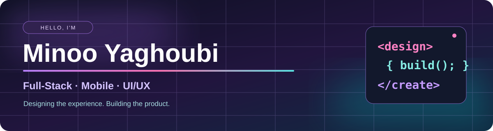

<div align="center">



<br/>

<a href="https://react-vite-portfolio-five.vercel.app/"></a>
<a href="mailto:minoo.yaghoubi@gmail.com"></a>
<a href="https://github.com/Minoo-YH?tab=repositories"></a>

<br/><br/>


</div>

## A little about me

Hi, I'm Minoo. I'm studying Software Engineering (Mobile Solutions) at **Metropolia University of Applied Sciences** in Finland.

I enjoy both sides of making software: figuring out how something should look and feel, and then building it. I've worked on mobile interfaces during an internship, improved a real company website, built backend APIs, and helped turn an idea for supporting senior citizens into the **APUA** mobile app project.

I care about small design details, but I also like debugging, testing, and understanding how the pieces fit together. Right now I'm developing my skills in **full-stack and mobile development**, with more hands-on work in **CI/CD and cloud tools**.

**Open to junior full-stack, mobile and software developer opportunities in Finland.**

## My toolkit

<div align="center">


<br/><br/>


</div>

<sub>Also working with React Native, Expo, ASP.NET Core, SQL Server, Entity Framework Core, JUnit 5, JaCoCo, Maven and Figma prototyping. Tools here reflect coursework, projects and internships—not the same level of experience with every technology.</sub>

## Things I've built

<table>
<tr>
<td width="50%" valign="top">

### 🧩 HelpDesk API
**C# · ASP.NET Core · SQL Server · JWT**

A support ticket API with authentication, roles, ticket management, comments, and Swagger documentation. I built it to get more comfortable designing and securing backend services.

</td>
<td width="50%" valign="top">

### 📱 APUA — Mobile App
**React Native · Expo · TypeScript · Figma**

I'm co-founding and developing an app to help senior citizens find everyday support. I work on the frontend, prototypes, user testing and coordinating our three-person team.

*In development*

</td>
</tr>
<tr>
<td valign="top">

### ⚙️ [Java Testing & CI/CD](https://github.com/Minoo-YH/JaCoC0)
**Java · JUnit 5 · JaCoCo · Jenkins · Docker**

A temperature converter that grew into a JavaFX and SQLite application. I set up automated tests, coverage reports, a Jenkins pipeline and Docker image publishing. The latest documented run had **7 passing tests**.

[See the pipeline and screenshots →](https://github.com/Minoo-YH/JaCoC0)

</td>
<td valign="top">

### ✈️ Full-Stack Travel Website
**React · Node.js · Express · MongoDB · Stripe**

A university team project with payments, authentication, an admin dashboard and backend APIs. A good chance to work across the stack with other developers.

</td>
</tr>
<tr>
<td valign="top">

### 🤝 Help Connect
**React · Tailwind CSS · Figma**

I came up with the idea for a community support platform, designed its UI in Figma and developed the frontend as part of a university project.

</td>
<td valign="top">

### 🌐 [CoReorient Website](https://github.com/Minoo-YH/Coreorient-website)
**WordPress · PHP · JavaScript · CSS**

During my internship I fixed a long-standing website issue, built a custom WordPress plugin, and worked on SEO and security improvements.

[View repository →](https://github.com/Minoo-YH/Coreorient-website)

</td>
</tr>
</table>

## From design to delivery

```text
Idea & user needs  →  Figma & UI/UX  →  Frontend & APIs  →  Tests  →  Build & ship
```

- **Design:** Prototypes, accessible interfaces, responsive layouts and usability feedback.
- **Development:** React, React Native, TypeScript, Node.js, ASP.NET Core and databases.
- **Quality:** Unit tests, API checks, JaCoCo coverage reports and debugging.
- **Delivery:** Git workflows, Docker, Jenkins pipelines and GitHub Actions.

## Where I've worked

**APUA — Co-Founder & Lead Developer** · Mobile frontend, product design, team coordination and user testing  
**Vesko — Frontend Mobile Developer Intern** · Notification feature, Figma collaboration and Scrum  
**CoReorient — Web Developer Intern** · WordPress, PHP, custom plugin, bug fixes and SEO

## GitHub, in motion

<div align="center">


<br/><br/>

<!-- This animation appears after the included GitHub Actions workflow has run. -->


</div>

## Outside the editor

I like skiing, cycling, hiking and photography. I also enjoy discovering new places and finding small ideas that might turn into my next project.

<div align="center">

### Have an idea or want to work together?

**[See my portfolio](https://react-vite-portfolio-five.vercel.app/) · [Explore my repositories](https://github.com/Minoo-YH?tab=repositories) · [Send me an email](mailto:minoo.yaghoubi@gmail.com)**


<sub>Designed with a little color, curiosity and plenty of coffee ☕</sub>

</div>


